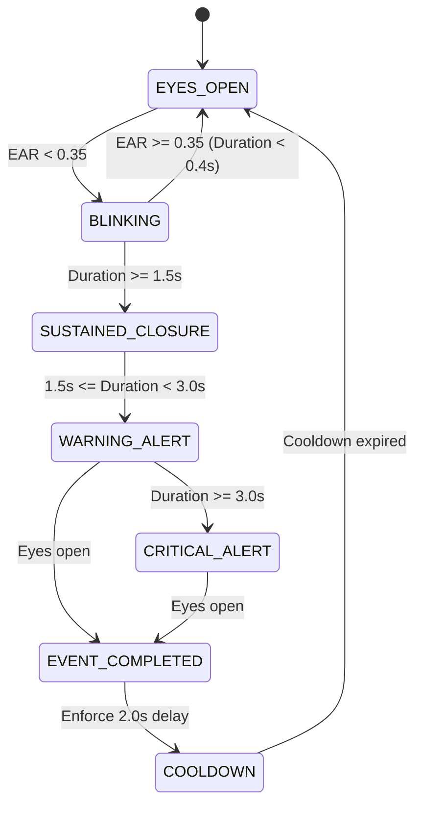

# System Architecture: Independent Driver & Owner Services

## 1. Architectural Philosophy & Separation of Concerns

The platform is partitioned into two completely independent, loosely coupled services:

1. **Driver Monitoring Service (`driver_service`):**
   - **Mission:** High-frequency, deterministic real-time computer vision inference directly on the vehicle edge (laptop / embedded PC).
   - **Safety Invariant:** Local alerts (audible alarm and visual HUD) **must never depend on network connectivity, backend availability, or cloud/LLM response times**.
   - **Offline Tolerance:** If the vehicle is disconnected from the internet or the owner backend is offline, monitoring and local warnings operate with 100% fidelity. Completed events are persisted to a local `data/events.json` buffer.

2. **Owner Management Service (`owner_service`):**
   - **Mission:** Fleet aggregation, multi-vehicle telemetry ingestion, historical analytics, and natural-language risk explanations.
   - **Architecture:** FastAPI async event ingestion, SQLite ACID storage, WebSockets for push notifications, and a Vite/React dashboard.
   - **Local AI (Gemma via Ollama):** Analyzes driver fatigue patterns on demand. If Ollama is offline or low on VRAM, the backend logs a notice and continues operating without failing any HTTP routes.

---

## 2. Service Separation & Data Flow

```text
+-----------------------------------------------------------------------+
|                       DRIVER MONITORING SERVICE                       |
|                                                                       |
|   Laptop Webcam / Video  -->  CameraManager                           |
|                                     |                                 |
|                                     v                                 |
|               +---------------------+-------------------+             |
|               |                                         |             |
|               v                                         v             |
|        FaceMeshDetector                          PhoneDetector        |
|         (MediaPipe 468)                          (YOLOv8 CoCo)        |
|               |                                         |             |
|        EAR, MAR, Landmarks                       BBox, Confidence     |
|               |                                         |             |
|       +-------+-------+                                 |             |
|       |               |                                 |             |
|       v               v                                 |             |
|  Drowsiness /    PostureDetector                        |             |
|  Yawn Detectors  (Pitch, Roll, Ratio)                   |             |
|       |               |                                 |             |
|       +-------+-------+                                 |             |
|               |                                         |             |
|               +--------------------+--------------------+             |
|                                    |                                  |
|                                    v                                  |
|                              Event Manager                            |
|                        (Temporal State Machines)                      |
|                                    |                                  |
|                    +---------------+---------------+                  |
|                    |                               |                  |
|                    v                               v                  |
|              AlarmManager                    HUDVisualizer            |
|         (Local Pygame / Beep)             (HUD Alert Overlay)         |
|                    |                                                  |
|                    v                                                  |
|          Local events.json buffer                                     |
+--------------------|--------------------------------------------------+
                     |
                     | HTTP POST /api/events (Async background thread)
                     v
+--------------------------------------------------------------+
|                  OWNER MANAGEMENT SERVICE                    |
|                                                              |
|                     FastAPI Backend                          |
|                     (Port 8000)                              |
|                          |                                   |
|            +-------------+-------------+                     |
|            |                           |                     |
|            v                           v                     |
|     SQLite Database             WebSocket Stream             |
|    (fleet_safety.db)                (/ws)                    |
|            |                           |                     |
|            |                           v                     |
|            |                  React Owner Dashboard          |
|            |                       (Port 5173)               |
|            |                           |                     |
|            +-------------+-------------+                     |
|                          |                                   |
|                          v                                   |
|                 Gemma AI Assistant                           |
|                (via local Ollama)                            |
+--------------------------------------------------------------+
```

---

## 3. Shared Event Schema Contract

The shared contract between both services is defined in `shared/event_schema.py`:

```json
{
  "event_id": "evt_a1b2c3d4",
  "driver_id": "DRV001",
  "driver_name": "Prototype Driver",
  "vehicle_id": "VEH001",
  "vehicle_no": "Cabin Rig 01",
  "session_id": "sess_20261026_180000",
  "event_type": "DROWSINESS",
  "start_time": "2026-10-26T12:30:00.000000Z",
  "end_time": "2026-10-26T12:30:02.800000Z",
  "duration": 2.8,
  "severity": "WARNING",
  "status": "DROWSINESS_DETECTED",
  "confidence": null,
  "metrics": {
    "avg_ear": 0.19,
    "min_ear": 0.16
  },
  "explanation": null,
  "timestamp": "2026-10-26T12:30:02.800000Z"
}
```

---

## 4. Cooldown and Anti-Flicker State Machine


